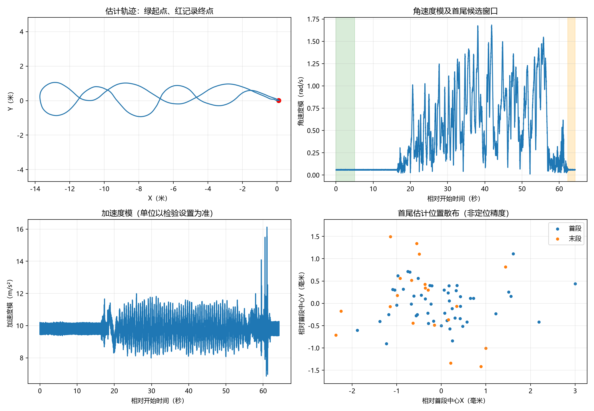

# Dataset_Init：ROS1 BAG 数据集检验

只读取一个 ROS1 `.bag`，检验文件结构、消息解码、时间连续性、IMU/点云质量、首尾静止候选段及轨迹内部一致性。终端打印对齐的中文表格，并输出 Markdown、CSV、JSON；绘图脚本生成中文检验表和运动概览。

无需安装 ROS、无需飞控 BIN/RLOG/TLOG、无需 GPU。分析过程只读 BAG，不自动修复或覆盖输入文件。仓库只提供程序、合成测试与示例结果，不包含原始数据集。

[查看 Markdown 示例检验表](#示例检验表) · [查看运动分析图](examples/real02/charts/motion_summary.png)

## 1. 安装部署

建议 Python 3.10～3.12。已在 Windows / Python 3.12 完成本地验证；仓库配置了 Windows、Ubuntu 与 Python 3.10/3.12 的 GitHub Actions 测试，以实际 Actions 结果为准。

### Windows PowerShell

```powershell
git clone https://github.com/GHigher12/Dataset_Init.git
cd Dataset_Init
python -m venv .venv
# 不需要激活虚拟环境，直接调用其解释器
.\.venv\Scripts\python.exe -m pip install -r requirements.txt
.\.venv\Scripts\python.exe -X utf8 check_bag_dataset.py --help
```

### Linux / macOS

```bash
git clone https://github.com/GHigher12/Dataset_Init.git
cd Dataset_Init
python3 -m venv .venv
.venv/bin/python -m pip install -r requirements.txt
.venv/bin/python check_bag_dataset.py --help
```

依赖：`numpy`、`rosbags`；绘图另使用 `matplotlib`，均已写入 requirements.txt。

## 2. 检验自己的 BAG

```powershell
.\.venv\Scripts\python.exe -X utf8 check_bag_dataset.py `
  --bag "E:\Datasets\test02.bag" `
  --output "results\test02" `
  --start-window 5 `
  --end-window 2 `
  --accel-unit auto
```

Linux/macOS 使用同样参数，将解释器换为 `.venv/bin/python`，路径换成本机路径；可将命令写成一行。

`--bag` 是文件路径，不是目录。输出目录必须不存在，避免覆盖历史结果；不指定 `--output` 时会自动新建 `bag_checks/时间戳`。大点云 BAG 会全量解码，需要等待“完成”提示。

### 参数

| 参数 | 默认值 | 作用 |
| --- | --- | --- |
| `--bag` | 必填 | 一个 ROS1 BAG 文件 |
| `--output` | `bag_checks/时间戳` | 新建结果目录 |
| `--start-window` | `5` | 首段候选窗口，秒，至少 1 秒 |
| `--end-window` | `2` | 末段候选窗口，秒，至少 1 秒 |
| `--gap-factor` | `5` | 采样大间隔阈值：正时间间隔中位数的倍数，必须大于 1 |
| `--accel-unit` | `auto` | `auto`、`g` 或 `mps2`，表示 IMU 原始加速度单位 |
| `--imu-topic` | `/livox/imu` | `sensor_msgs/Imu` 话题 |
| `--lidar-topic` | `/livox/lidar` | Livox `CustomMsg` 话题 |
| `--pose-child` | `aft_mapped` | `/tf` 中用于提取轨迹的子坐标系，忽略名称开头的 `/` |

`auto` 模式下，加速度模中位数在 0.5～2 时暂按 g 乘 9.80665，否则暂按 m/s²。这个推断不是单位标定，建议核对驱动后显式指定。当前点云检查针对含 `header`、`point_num`、`points[].x/y/z` 的 Livox CustomMsg；普通 PointCloud2 不属于本脚本的 Livox 点数/XYZ 检查范围。自定义消息定义从 BAG 内读取。

## 3. 检验哪些指标

只包含下列 16 项。`True` 表示该项检查通过；`False` 表示未通过或证据不足。不会因为此前某份 BAG 通过，就隐藏新数据的 False。

| 序号 | 类别 | 检验指标 | 判定依据 / 输出数值 |
| ---: | --- | --- | --- |
| 1 | 文件结构 | BAG 能否完整读取 | 遍历成功，且至少有一条消息；输出消息数与读取异常 |
| 2 | 文件结构 | 消息能否正确解码 | 全量读取完成，所有消息解码失败数为 0 |
| 3 | 文件结构 | 实际消息数是否与索引一致 | 按话题比较索引数与实际读取数 |
| 4 | 文件结构 | 必要话题是否存在 | 配置的 IMU 和 Livox 点云话题都能解码到对应类型的消息 |
| 5 | 文件保护 | 分析期间文件是否保持不变 | 分析前后整份文件 SHA256 一致 |
| 6 | 时间质量 | 传感器时间戳是否无回退 | IMU 与点云消息头时间回退次数均为 0 |
| 7 | 时间质量 | 传感器时间戳是否无重复 | 两个传感器重复时间戳次数均为 0 |
| 8 | 时间质量 | 是否无明显采样缺口 | 两个传感器超过中位正时间间隔 × gap-factor 的次数均为 0 |
| 9 | 数值质量 | IMU 加速度及角速度是否有限 | NaN、Inf 总数为 0 |
| 10 | 点云质量 | Livox 声明点数是否与实际一致 | `point_num == len(points)` 的不符次数为 0 |
| 11 | 点云质量 | Livox XYZ 坐标是否有限 | 全部点的 XYZ 中 NaN、Inf 总数为 0 |
| 12 | 点云质量 | 是否无空点云 | 空点云帧数为 0 |
| 13 | 静止候选段 | 首段是否支持近似静止 | IMU 低动态诊断和位姿变化联合筛查，详见下方阈值 |
| 14 | 静止候选段 | 末段是否支持近似静止 | 同上，使用末尾 end-window 秒 |
| 15 | 轨迹分析 | 能否计算轨迹内部指标 | 有效轨迹至少 3 条；数值有限、时间严格递增、父坐标系唯一、四元数模与 1 的差小于 0.001；输出时长与折线路径长度 |
| 16 | 轨迹分析 | 能否计算条件性闭合残差 | 首尾静止候选段均通过，且各有至少 3 条位姿；输出平均位置差和平均姿态差 |

时间检查只针对配置的两个传感器话题，不把 `/rosout` 等事件话题当周期采样；采样间隔统计保存在 JSON。缺少话题、样本不足、消息类型不符或无法读取，对应项目均为 False。

### 静止候选段阈值

阈值是可复核的启发式筛查，写在 `quiet_window()` 中，不是设备验收标准：

| 指标 | 条件 |
| --- | --- |
| 样本数量 | IMU 至少 20 条，位姿至少 3 条 |
| 有效时间覆盖 | IMU 与位姿覆盖均不低于窗口时长的 80% |
| 时间质量 | IMU 无超出 gap-factor 的大间隔；用于分析的 IMU/轨迹时间严格递增 |
| 去均值角速度模 P95 | 小于 0.03 rad/s |
| 0.2 秒平滑加速度向量残差 RMS | 小于 0.15 m/s² |
| 轨迹速度 P95 | 小于 0.05 m/s，使用 0.2 秒位置差分 |
| 位姿相对窗口中心位置半径 P95 | 小于 0.02 m |
| 相对窗口初始姿态角变化 P95 | 小于 0.5° |

原始角速度均值、原始角速度模 P95、原始加速度残差也保留在 JSON。去均值和滤波只用于低动态诊断，不代表传感器已完成偏置标定；不能据此掩盖原始噪声。

## 4. 输出结果与图表

```text
results/test02/
├── 检验结果_中文.md       # 16项中文表格，最后一列 True/False
├── 检验指标.csv          # 同一表格，UTF-8 BOM，可用Excel打开
├── 检验指标.json         # 布尔结果、参数、哈希、时间统计和详细指标
├── imu.csv               # 可分析时输出：时间、原始加速度、角速度
├── trajectory.csv        # 可分析时输出：时间、XYZ、四元数
└── charts/               # 运行绘图脚本后生成
    ├── metrics_table.png
    └── motion_summary.png
```

```powershell
.\.venv\Scripts\python.exe -X utf8 plot_bag_report.py --report "results\test02\检验指标.json"
```

有 IMU 与轨迹 CSV 时，额外生成 XY 轨迹、角速度模、加速度模和首尾位置分布图；缺少 CSV 时仍可生成指标表图。图表目录默认位于报告旁的 `charts`，也可用 `--output` 指定。绘图脚本会覆盖目标目录中同名 PNG，检验脚本则要求新建输出目录。

若图表中文显示方框，请安装中文字体，或直接指定本机字体文件：

```powershell
.\.venv\Scripts\python.exe plot_bag_report.py --report "results\test02\检验指标.json" --font "C:\Windows\Fonts\msyh.ttc"
```

Linux/macOS 可以使用本机的 Noto Sans CJK 等中文字体，`--font` 同样接受 `.ttf`、`.ttc`、`.otf` 路径。

### 实际示例：02 手持测试的恢复副本

完整结果见 [示例中文报告](examples/real02/report.md)、[CSV](examples/real02/metrics.csv)、[JSON](examples/real02/report.json)。本次示例 16 项均为 True；原始数据不随仓库发布，示例中的本机输入路径已替换为示例名称。

### 示例检验表

采用原生 Markdown 表格，可直接复制、编辑和查看。状态采用彩色标记：🟢 **True**（通过）、🔴 **False**（未通过或证据不足）。颜色仅辅助阅读，仍保留明确的布尔文字。

| 类别 | 检验指标 | 实测结果 | 通过 |
| --- | --- | --- | :---: |
| 文件结构 | BAG能否完整读取 | 遍历消息 17,370 条；读取异常 0 | 🟢 **True** |
| 文件结构 | 消息能否正确解码 | 解码失败 0 条 | 🟢 **True** |
| 文件结构 | 实际消息数是否与索引一致 | 索引 17,370 条，实际 17,370 条 | 🟢 **True** |
| 文件结构 | 必要话题是否存在 | /livox/imu 有效解码 12,858 条；/livox/lidar 643 帧 | 🟢 **True** |
| 文件保护 | 分析期间文件是否保持不变 | 分析前后SHA256一致 | 🟢 **True** |
| 时间质量 | 传感器时间戳是否无回退 | /livox/imu 回退 0 次；/livox/lidar 回退 0 次 | 🟢 **True** |
| 时间质量 | 传感器时间戳是否无重复 | /livox/imu 重复 0 次；/livox/lidar 重复 0 次 | 🟢 **True** |
| 时间质量 | 是否无明显采样缺口 | /livox/imu 大间隔 0 次；/livox/lidar 大间隔 0 次 | 🟢 **True** |
| 数值质量 | IMU加速度及角速度是否为有限值 | 加速度/角速度 NaN及Inf 0 个 | 🟢 **True** |
| 点云质量 | Livox声明点数是否与实际一致 | 点数不符 0 | 🟢 **True** |
| 点云质量 | Livox XYZ坐标是否为有限值 | XYZ非法数值 0 | 🟢 **True** |
| 点云质量 | 是否无空点云 | 空点云 0 | 🟢 **True** |
| 静止候选段 | 首段是否支持近似静止 | 5秒窗口：联合支持近似静止，雷达IMU偏置与噪声仍需复核 | 🟢 **True** |
| 静止候选段 | 末段是否支持近似静止 | 2秒窗口：联合支持近似静止，雷达IMU偏置与噪声仍需复核 | 🟢 **True** |
| 轨迹分析 | 能否计算轨迹内部指标 | 轨迹 643 条，64.203 秒，折线路径 34.612 米 | 🟢 **True** |
| 轨迹分析 | 能否计算条件性闭合残差 | 平均位置差 0.559 mm；姿态差 0.3026°；首尾近似静止均支持 | 🟢 **True** |

### 示例关键数值

| 指标 | 示例数值 |
| --- | ---: |
| 全部读取消息数 | 17,370 |
| IMU 消息数 | 12,858 |
| Livox 点云帧数 | 643 |
| IMU 时间跨度 | 约 64.284 秒 |
| 轨迹折线路径长度 | 约 34.612 米 |
| 首/末候选窗口 | 5 / 2 秒 |
| 首尾平均位置差 | 约 0.559 毫米 |
| 平均姿态旋转差 | 约 0.3026° |



这些数值只描述当前文件和估计轨迹。0.559 毫米小于段内约 1 毫米的位置散布，不是亚毫米精度证明；末尾 5 秒包含转动，示例采用通过筛查的末 2 秒，而不是按最小残差选窗。

## 5. 运行测试

```powershell
.\.venv\Scripts\python.exe -X utf8 -m unittest -v test_check_bag_dataset.py
```

四项合成 BAG 测试覆盖：正常样例 16 项均通过；非法 IMU/点云数值、点数不符及时间回退被检出；缺少数据不被误判为通过；截断文件仍生成失败表格。测试自行生成临时 BAG，不需要下载数据集。

## 6. 常见问题与结果边界

- **`Bag is not indexed`**：输入 BAG 缺少索引，脚本会输出 False；应先对副本重建索引/抢救数据，再检查恢复副本。本仓库不提供自动修复功能，重命名不能修复文件。
- **没有轨迹相关结果**：检查是否有 `/tf`，其子坐标系是否与 `--pose-child` 一致。其他轨迹消息类型（如 nav_msgs/Odometry）暂不解析。轨迹缺失不妨碍读取/解码项目独立判断。
- **首尾静止为 False**：候选窗口可能混有移动或转动，也可能是传感器噪声、单位配置或位姿覆盖不足。检查 JSON 原始统计后调整窗口，避免只为获得 True 放宽条件。
- **目录已存在**：换一个 `--output`，或者省略此参数使用自动时间戳目录。
- **退出码**：0 表示所选 16 项全部通过；1 表示至少一项 False；参数错误由 argparse 返回 2。文件权限或输出写入等运行时异常可能直接报错，应检查完整错误日志。
- **16 项 True 的含义**：只代表本表所选检查通过，不代表原始采集一定完整、没有任何丢帧或适合所有算法。没有可信采集前基线时，SHA256 只能证明本次分析期间未变。
- **闭合残差的条件**：还需由实验记录确认同一物理位置出发返回、坐标系连续。“能计算”不表示达到某个闭合误差验收阈值。
- 不评估雷达与飞控运动配对、跨设备同步、绝对定位精度、真实累计漂移或多次落座重复性。仅 BAG 的 IMU 和估计轨迹可能共享信息源，不能互作独立真值。
